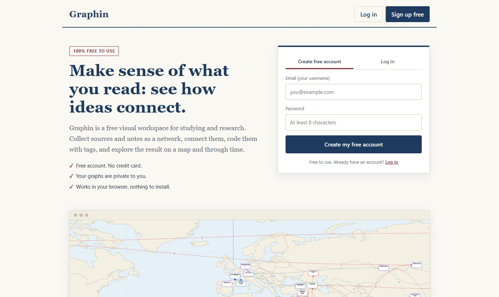
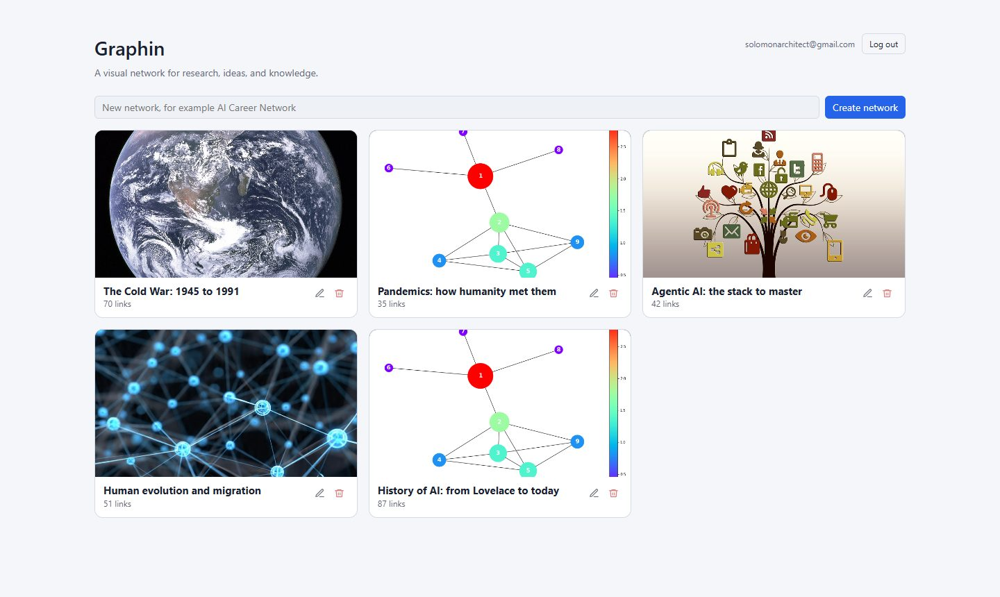
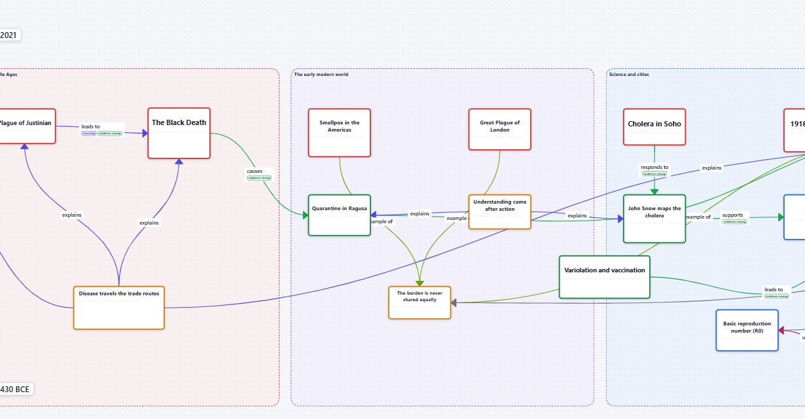
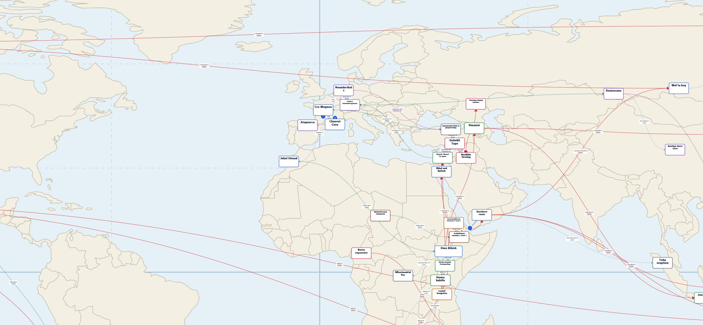

# Graphin

**A visual network for research, ideas and knowledge.** Collect sources and notes as tiles on an open canvas, connect them, code them with tags, and explore the result on a map and through time.

Graphin runs as a web app (PHP + MariaDB) and as a free Windows desktop app (the same code with a bundled PHP and a SQLite file).



## What it does

- **Tiles on a canvas.** One kind of tile: a title, notes, tags, and any number of links to pages, images, videos and PDFs (the first picture or video shows on the tile). Plus free-text labels and shapes. Drag, resize, restyle and group them.
- **Rich notes.** Notes are written in Markdown, with LaTeX maths (`$x^2# Graphin

**A visual network for research, ideas and knowledge.** Collect sources and notes as tiles on an open canvas, connect them, code them with tags, and explore the result on a map and through time.

Graphin runs as a web app (PHP + MariaDB) and as a free Windows desktop app (the same code with a bundled PHP and a SQLite file).


## What it does

- **Tiles on a canvas.** One kind of tile: a title, notes, tags, and any number of links to pages, images, videos and PDFs (the first picture or video shows on the tile). Plus free-text labels and shapes. Drag, resize, restyle and group them.
 and `$…$`). Hover a link to preview the page, image or video in place, or open a tile full screen to read it with its relationships written out as sentences.
- **Wiki links.** Type `[[Other tile | supports | shown text]]` in a note and Graphin links to that tile and draws a labelled arrow for you; it suggests tile names as you type, and removes the arrow if you delete the link.
- **Autosave.** Edits to a tile are saved as you type, with a status line that shows when they are safe.
- **Typed relationships.** Link two tiles with a standard relationship (supports, contradicts, causes, leads to and others) or your own. Two tiles can be joined by any number of links, as long as each has a different relationship; they are drawn side by side.
- **Editable curves.** Links curve smoothly. Drag a label to bend a line, double-click the line to add more points, and shape it concave and convex. Double-click the label to straighten it.
- **Tags and colour coding.** Tag tiles and links, filter by tag, and colour the whole graph by tag (border or fill).
- **Map view.** Give a tile a place and see it on a world map with several map types. Lay a graph out by geography in one click.
- **Time view.** Date tiles (even millions of years back) and scrub a time slider, or lay the graph out as a timeline.
- **References and commentary** stay attached to each tile.
- **Accounts.** Register with your name, an email address (the username) and a password. The address is confirmed by email, and a forgotten password is reset by email. Everyone sees only their own graphs. A dashboard of picture tiles lists them, each with a cover image, an editable name and a background colour.
- **Share by link.** The owner makes a private read-only link to a graph; anyone with it can look around without an account, and can copy the graph into their own account. The owner can stop sharing or change the link at any time.
- **Capture from the browser.** A bookmarklet and a Chrome/Edge extension (right-click a page, link or selection and choose the graph) save into a graph, and an open Graphin tab updates at once.

| Dashboard | Colour coding by tag |
|---|---|
|  |  |



## How it is built

| Part | Technology |
|---|---|
| Interface | React 18, [React Flow](https://reactflow.dev) (`@xyflow/react`), Vite |
| API | PHP 8 with the Slim 4 framework, JSON over REST under `/api` |
| Data | MariaDB / MySQL on the web; SQLite in the desktop app |
| Desktop | [Tauri](https://tauri.app) shell with a bundled PHP runtime (see [desktop/README.md](desktop/README.md)) |
| Sign-in | PHP sessions (HttpOnly, SameSite cookie), `password_hash` for passwords, a required `X-Requested-With` header on writes, and ownership checks on every graph, tile and link |

One codebase serves both versions. On the desktop the server runs on the user's own machine with no login.

## Run it locally

You need PHP 8.0 or later (with `pdo_mysql` and `mbstring`), [Composer](https://getcomposer.org), MariaDB 10.2+ or MySQL 5.7+, and Node.js. XAMPP works well on Windows.

```bash
# 1. PHP dependencies
composer install

# 2. Database (creates the "graphin" database and its tables)
mysql -u root < schema.sql

# 3. Settings: copy the example and edit it if your database settings differ
cp .env.example .env

# 4. Build the interface (the output goes to public/)
cd frontend
npm install
npm run build
cd ..

# 5. Start the server
php -S 127.0.0.1:8100 -t public public/index.php
```

Open <http://127.0.0.1:8100>, choose **Create free account**, and you are in. (Use `127.0.0.1` rather than `localhost`: on some machines `localhost` resolves to IPv6 first, which makes the built-in server slow.)

To create or reset a user from the command line:

```bash
php bin/create-user.php you@example.com "a good password"
# add --adopt to give this user every graph that has no owner yet
```

### Developing the interface

```bash
cd frontend
npm run dev     # Vite dev server; /api is proxied to http://localhost:8100
```

Keep the PHP server running on port 8100 while you do this.

### Sample graphs

The `seed/` folder holds scripts that build ready-made graphs through the API: how we learned to map the world (a small one to start with: pictures, videos, Wikipedia, wiki links and multiple relationships), pandemics, human evolution and migration, European imperialism, and the agentic-AI stack. Each one stops if its graph already exists.

```bash
GRAPHIN_EMAIL=you@example.com GRAPHIN_PASSWORD="a good password" \
  node seed/mapping-the-world.mjs http://127.0.0.1:8100
```

### Settings and secrets

Password, host and other settings live in `.env` (local) or `config.local.php` (on the server). Both are ignored by git; the repository holds only the placeholder files `.env.example` and `deploy/config.local.example.php`. Never commit real values. Deployment logins go in `deploy/sftp.txt`, also ignored.

An existing database needs the matching script from `deploy/migrate-*.sql` when a release adds a column or table; a new database made from `schema.sql` already has them.

### Desktop app

See [desktop/README.md](desktop/README.md) for building the Windows installer.

## Project layout

| Path | What it is |
|---|---|
| `public/index.php` | Entry point: routes `/api` and serves the built app |
| `src/` | PHP code: controllers for networks, nodes, edges, pages and auth; database layer; style validation |
| `frontend/src/` | The React app: components, layouts, tags, map and time scales |
| `schema.sql`, `schema-sqlite.sql` | Database schemas (MariaDB and SQLite) |
| `seed/` | Scripts that create sample graphs |
| `extension/` | Browser extension (Chrome and Edge) for saving pages and highlights |
| `deploy/` | Deployment script for shared hosting, example settings and SQL migrations for existing databases |
| `desktop/` | Tauri project for the Windows app |
| `bin/` | Command-line tools |

## Status and roadmap

Graphin is a working project under active development. Not built yet:

- Automated tests
- Sharing with named people or letting others edit (links are read-only)
- Firefox support for the extension

## Contributing

Contributions are welcome: bug reports, ideas, fixes and new features. Open an issue to discuss a larger change first, and keep a pull request to one thing. Run the app locally as above, build the interface (`npm run build` in `frontend`) before you send it, and do not include passwords, keys or personal data in code, seed scripts or screenshots. By contributing you agree your work is released under the same licence (below).

## Licence

Copyright (C) 2026 Solomon Tessema.

Graphin is free software, released under the [GNU Affero General Public License](LICENSE), version 3 or (at your option) any later version. You may use, study, change and share it. If you run a modified version as a service that other people use over a network, you must make your modified source code available to those users under the same licence.

The Graphin name and the graphin.org site are not covered by the licence.
