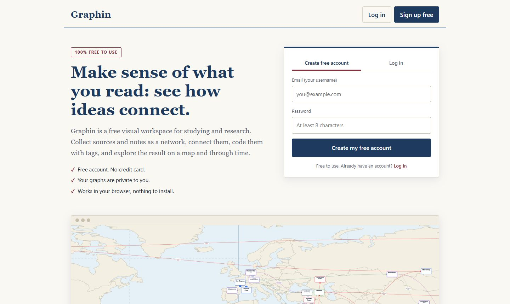
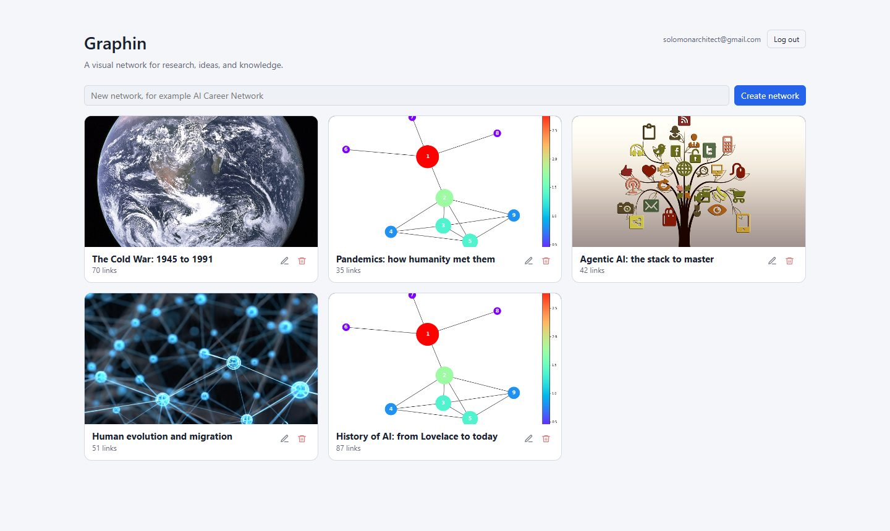
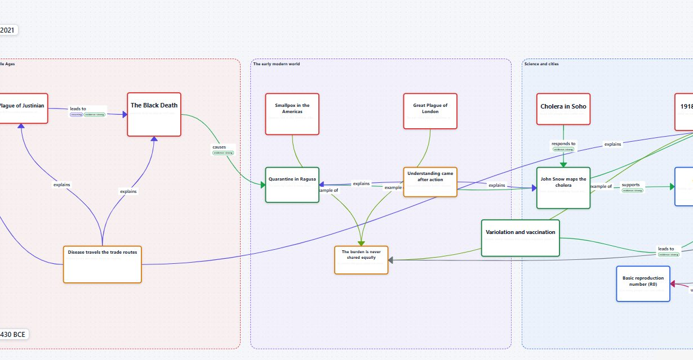
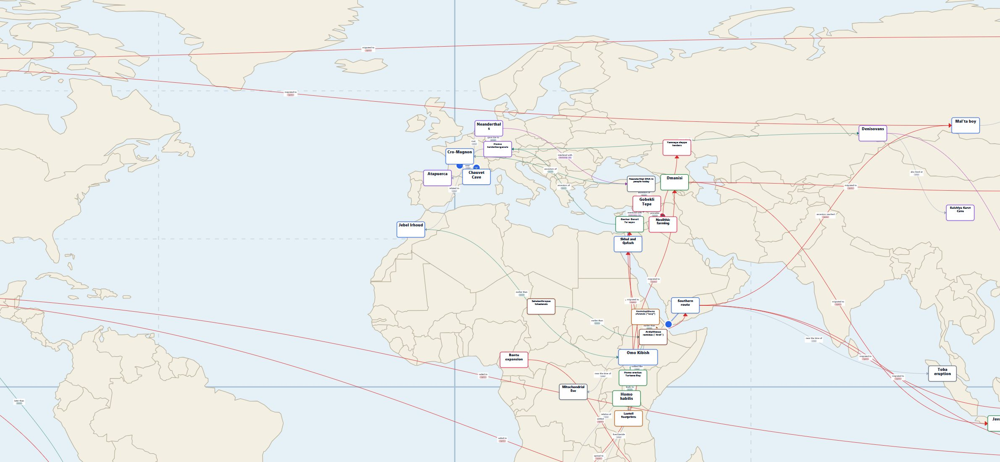

# Graphin

**A visual network for research, ideas and knowledge.** Collect sources and notes as tiles on an open canvas, connect them, code them with tags, and explore the result on a map and through time.

Graphin runs as a web app (PHP + MariaDB) and as a free Windows desktop app (the same code with a bundled PHP and a SQLite file).



## What it does

- **Tiles on a canvas.** Web pages, PDFs, images, videos, notes, labels and shapes. Drag, resize, restyle and group them.
- **Typed relationships.** Link two tiles with a standard relationship (supports, contradicts, causes, leads to and others) or your own. Two tiles can be joined by any number of links, as long as each has a different relationship; they are drawn side by side.
- **Editable curves.** Links curve smoothly. Drag a label to bend a line, double-click the line to add more points, and shape it concave and convex. Double-click the label to straighten it.
- **Tags and colour coding.** Tag tiles and links, filter by tag, and colour the whole graph by tag (border or fill).
- **Map view.** Give a tile a place and see it on a world map with several map types. Lay a graph out by geography in one click.
- **Time view.** Date tiles (even millions of years back) and scrub a time slider, or lay the graph out as a timeline.
- **References and commentary** stay attached to each tile.
- **Accounts.** Register with an email address (the username) and password. Everyone sees only their own graphs. A dashboard of picture tiles lists them, each with a cover image, an editable name and a background colour.
- **Capture from the browser.** A bookmarklet and a browser extension save the page, a link or highlighted text into a graph.

| Dashboard | Colour coding by tag |
|---|---|
|  |  |



## How it is built

| Part | Technology |
|---|---|
| Interface | React 18, [React Flow](https://reactflow.dev) (`@xyflow/react`), Vite |
| API | PHP 8 with the Slim 4 framework, JSON over REST under `/api` |
| Data | MariaDB / MySQL on the web; SQLite in the desktop app |
| Desktop | [Tauri](https://tauri.app) shell with a bundled PHP runtime (see [desktop/README.md](desktop/README.md)) |
| Sign-in | PHP sessions (HttpOnly, SameSite cookie), `password_hash` for passwords, a required `X-Requested-With` header on writes, and ownership checks on every graph, tile and link |

One codebase serves both versions. On the desktop the server runs on the user's own machine with no login.

## Run it locally

You need PHP 8.0 or later (with `pdo_mysql` and `mbstring`), [Composer](https://getcomposer.org), MariaDB 10.2+ or MySQL 5.7+, and Node.js. XAMPP works well on Windows.

```bash
# 1. PHP dependencies
composer install

# 2. Database (creates the "graphin" database and its tables)
mysql -u root < schema.sql

# 3. Settings: copy the example and edit it if your database settings differ
cp .env.example .env

# 4. Build the interface (the output goes to public/)
cd frontend
npm install
npm run build
cd ..

# 5. Start the server
php -S 127.0.0.1:8100 -t public public/index.php
```

Open <http://127.0.0.1:8100>, choose **Create free account**, and you are in. (Use `127.0.0.1` rather than `localhost`: on some machines `localhost` resolves to IPv6 first, which makes the built-in server slow.)

To create or reset a user from the command line:

```bash
php bin/create-user.php you@example.com "a good password"
# add --adopt to give this user every graph that has no owner yet
```

### Developing the interface

```bash
cd frontend
npm run dev     # Vite dev server; /api is proxied to http://localhost:8100
```

Keep the PHP server running on port 8100 while you do this.

### Sample graphs

The `seed/` folder holds scripts that build ready-made graphs through the API: pandemics, human evolution and migration, and the agentic-AI stack. Each one stops if its graph already exists.

```bash
GRAPHIN_EMAIL=you@example.com GRAPHIN_PASSWORD="a good password" \
  node seed/pandemics.mjs http://127.0.0.1:8100
```

### Desktop app

See [desktop/README.md](desktop/README.md) for building the Windows installer.

## Project layout

| Path | What it is |
|---|---|
| `public/index.php` | Entry point: routes `/api` and serves the built app |
| `src/` | PHP code: controllers for networks, nodes, edges, pages and auth; database layer; style validation |
| `frontend/src/` | The React app: components, layouts, tags, map and time scales |
| `schema.sql`, `schema-sqlite.sql` | Database schemas (MariaDB and SQLite) |
| `seed/` | Scripts that create sample graphs |
| `extension/` | Browser extension for saving pages and highlights |
| `desktop/` | Tauri project for the Windows app |
| `bin/` | Command-line tools |

## Status and roadmap

Graphin is a working project under active development. Not built yet:

- Password reset and email confirmation
- Automated tests
- Sharing a graph with other people

## Licence

Copyright (C) 2026 Solomon Tessema.

Graphin is free software, released under the [GNU Affero General Public License](LICENSE), version 3 or (at your option) any later version. You may use, study, change and share it. If you run a modified version as a service that other people use over a network, you must make your modified source code available to those users under the same licence.

The Graphin name and the graphin.org site are not covered by the licence.
